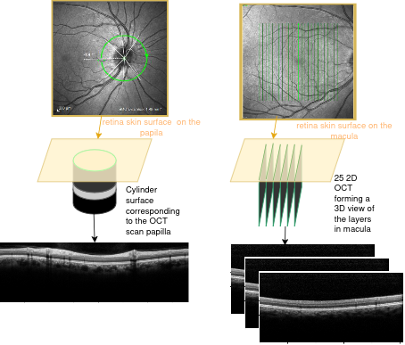
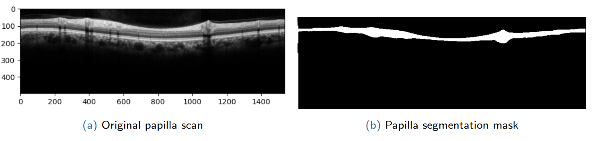
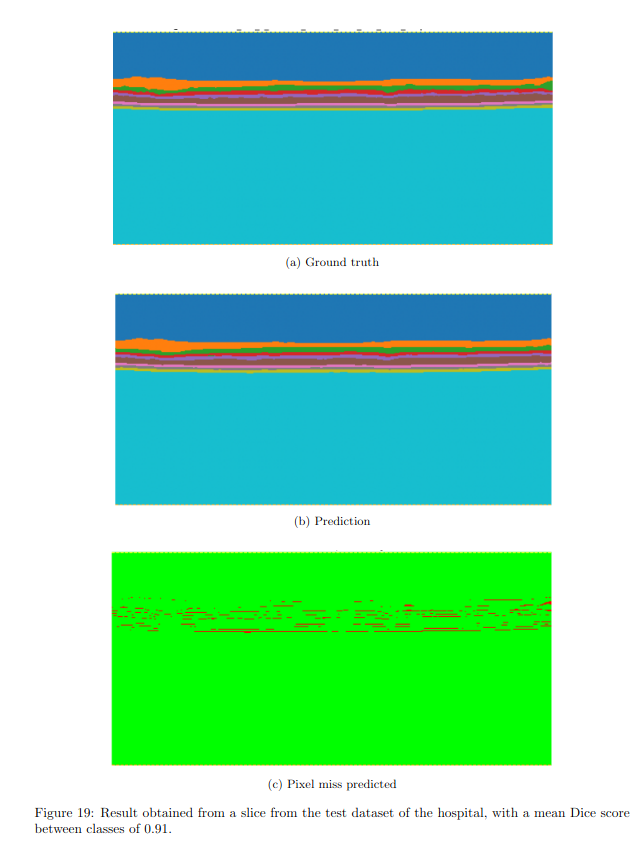

## Context

Multiple sclerosis (MS) is an autoimmune, degenerative disease of the central nervous system. Because axons in the retina are unmyelinated, the retina works as a direct, non-invasive "window into the brain": as the disease progresses, the retinal nerve fibre layer (RNFL) measurably thins. Optical Coherence Tomography (OCT) is a fast (~5 min), low-cost imaging technique that can capture this thinning, on two types of scans:

- **Peripapillary (papilla) scans** — a circular section around the optic disc, used to measure global and per-quadrant RNFL thickness.
- **Macula scans** — 25 slices around the macula, used to study several retinal layers (RNFL, GCL, IPL, INL, OPL, ONL, IS, OS, RPE...).

The problem: the segmentation algorithms built into commercial OCT devices are proprietary, black-box, and don't allow batch/automated extraction of data for research or large-scale patient follow-up.

Below, an example of the aquisisition of the OCT scan through the patient eyes.

## Objective

The goal of this Master 2 internship at CHU de Lille was to design an **open-source deep learning pipeline** able to:

1. Automatically segment the RNFL layer on peripapillary scans,
2. Automatically segment the ~9-10 retinal layers on macula scans,
3. Export per-quadrant / per-layer thickness measurements at scale, for both patient follow-up and MS research.

## Datasets

- **150 papilla scans** from 75 patients (Lille Hospital Centre), with two ground truths: manual doctor annotations (Freesurfer) and the segmentation extracted from the clinical OCT device's own software.
- **175 macula slices** from 6 patients (2 eyes × 25 slices), manually checked by a doctor.
- **HCMS public dataset** (35 patients, 14 healthy / 21 MS) used to benchmark against published methods.

## Proposed solution

The literature review (U-Net, Dense U-Net, Res U-Net, Attention U-Net, ReLayNet, BR-Net, BAU-Net...) showed that adding architectural complexity to U-Net (dense/residual/attention blocks) brings very little benefit on OCT images, since these images have a relatively simple, low-detail structure. So instead of proposing a new architecture variant, the internship focused on **preprocessing, data augmentation and loss design** around a modern (padded-convolution) U-Net:

- **Patch-based preprocessing**: OCT scans are much wider than tall, so instead of squashing them into a square (heavy zero-padding, loss of detail), each scan is split into square patches (496×496 for papilla) that are then downscaled to 256×256. Overlapping patches are merged by averaging at reconstruction.
- **Data augmentation**: elastic deformation (to simulate plausible layer shapes) and horizontal flips.
- **Loss functions tested**: Cross-Entropy + Dice (baseline), boundary-weighted variants (×10, ×20 penalty near borders), and boundary loss — to test whether explicitly penalizing border errors could beat the baseline.
- **Training**: Adam optimizer, 5-fold cross-validation, early stopping, LR scheduler, gradient clipping.

## Comparison with the benchmark

On the public **HCMS macula dataset**, the model was compared to AURA (Random Forest + graph search, pre-U-Net state of the art), plain U-Net, ReLayNet, BR-Net, SR-Net and BAU-Net:

| Metric | Result |
|---|---|
| Dice score (RNFL) | 93.4% — on par with U-Net-based literature |
| Dice score (other layers) | comparable to U-Net/ReLayNet, but slightly below border-aware architectures (BR-Net, SR-Net, BAU-Net) |
| MAD (border error) | ~2.95 µm on average — again close to plain U-Net, behind border-aware models |

**Takeaway:** boundary-weighted losses alone were not enough to close the gap with architectures that *structurally* enforce topological consistency between layer borders (BR-Net, BAU-Net). Reweighting pixels near the border helps a little, but explicit border-modeling components seem necessary to match state-of-the-art boundary precision. That said, the differences between all recent methods stay small (Dice within ~1-2 points, MAD within a fraction of a pixel), confirming an observation already reported in the literature: once a model reaches Dice > 0.90 on OCT, further gains are marginal.

## Results on the hospital data

**Peripapillary scans (clinical use case):**
- Dice score of **0.97** against the doctor's ground truth (vs. 0.96 against the clinical device's own segmentation).
- Mean thickness error of about **1.2 pixels** — matching the quality of the segmentation embedded in the clinical device.

**Macula scans:**
- Dice around 0.90-0.95 depending on the layer, with RNFL/GCIP performing best and OS/RPE being harder (thin, low-contrast layers).
- A pretrained model (HCMS → hospital data) transferred reasonably well, though with a measurable drop (~10% Dice) due to differences in acquisition device and layer nomenclature.

For example, here a result obtain of a slice with a mean dice score of 0.91.

## Clinical relevance: detecting MS via inter-eye asymmetry

A classic clinical proxy for MS is the **inter-eye asymmetry** in RNFL thickness (difference > 6 µm suggests a lesion). Using the model's predictions:

- **94%** of healthy patients were correctly identified as symmetric.
- **72%** of MS patients with a known optic-nerve lesion showed the expected asymmetry.
- **80%** of MS patients without a visible lesion (silent lesions) showed expected symmetry.

These numbers are consistent with the known limits of asymmetry as a *screening* indicator rather than a standalone diagnostic — it needs to be combined with MRI and clinical symptoms.

## Deliverable

The final model was packaged into a **Python script** that takes a folder of OCT scans as input and automatically outputs a table (CSV/Excel) of per-quadrant, per-layer thickness values, along with visual diagnostics of segmentation quality — a reusable foundation for future research or a web/GUI tool for the hospital.

## Conclusion & future work

The pipeline reaches clinical-grade accuracy on peripapillary scans and literature-level accuracy on macula scans, while staying architecturally simple. The main limitations are the **small macula dataset** at the hospital and the **remaining gap in border precision** compared to topology-aware architectures. Next steps: annotate more macula data, add a boundary-regression / topology-aware second stage (inspired by BR-Net/SR-Net), and validate the asymmetry indicator on a larger MS cohort.

*Supervised by Dr. Olivier Outteryck (CHU de Lille) and Prof. Ludovic Macaire (University of Lille), with Prof. Pierre Fortin as university tutor.*