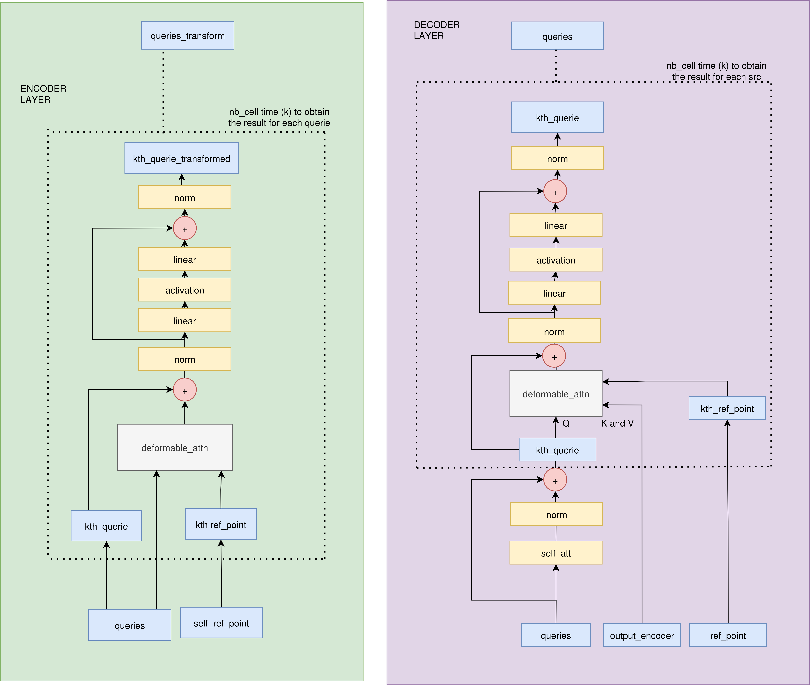
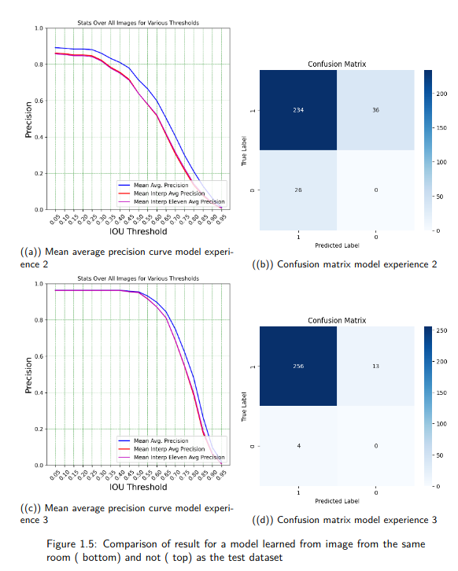

## Contexte

During my internship, I worked on a computer vision project aiming to automatically count people in indoor environments.

The broader objective was to link room occupancy with CO₂ measurements. A camera-based system could automatically provide the number of people present, avoiding manual annotation.

My work focused on implementing **DETR (DEtection TRansformer)** and studying improvements to the original architecture.

## Objective

The main objective was to develop a people detection model that could:

- detect people in indoor images,
- count the number of people present,
- generalize to rooms that were not used during training.

I also studied improvements to DETR, particularly **Anchor DETR** and **RCDA**, and investigated **Deformable DETR**.

## Dataset

The dataset was collected by the team using **Raspberry Pi cameras** installed in working rooms.

Images were captured every ten seconds, with images kept when the scene changed. Data was collected from **six different rooms** and annotated using **CVAT**.

Because the dataset was relatively small, an important part of the evaluation was testing the model on a room that was not used for training.

## Proposed solution

I first implemented the original **DETR** architecture, which combines a CNN backbone with a Transformer encoder-decoder.

A pretrained DETR model was first evaluated directly on our images, then fine-tuned on the collected dataset.

I also experimented with **Anchor DETR**. Anchor points provide spatial information to the object queries and helped the model converge faster.

Finally, I studied **RCDA (Row-Column Decoupled Attention)**, which reduces the computational cost of attention by processing the feature map along its rows and columns. I also investigated Deformable DETR, although its complete implementation was not finished during the internship.

The publications describing these models were analyzed not only to make use of their architectures, but also to understand in detail how they work. A PyTorch project was then created to bring the various implementations together. Below is an example of a diagram I made showing how Deformable DETR works, other diagrams of this types as been made for the other architecture.

## Result

The pretrained DETR model performed poorly on our images, mainly because of the specific camera angle and environment.

Fine-tuning significantly improved the detection of people. However, some false positives remained, particularly with objects such as chairs, while occluded people or people at the edge of the image were sometimes missed.

The experiments also showed that **room-specific training greatly improves performance**. This highlights the importance of testing on unseen rooms when evaluating the model's real-world generalization.
Below, we can see the difference in precision and the confusion matrices when the model is evaluated on a known room (experiment 3) and on a room it has never seen (experiment 2). Classification errors (except for difficult cases) correspond to information the model has never seen.

The experiments with Anchor DETR showed faster and more stable convergence than the standard DETR. RCDA alone was less effective, while combining RCDA with anchor points gave more promising results.

## Conslusion and future work

This internship allowed me to implement and study Transformer-based object detection with DETR in a real-world environment.

The main challenge was the limited generalization between different rooms. A larger and more diverse dataset would help reduce this bias.

Future work could include evaluating newer DETR-based models such as **RT-DETR**, completing the Deformable DETR implementation, improving temporal stability of the people count, and integrating the detector directly with the CO₂ monitoring system.